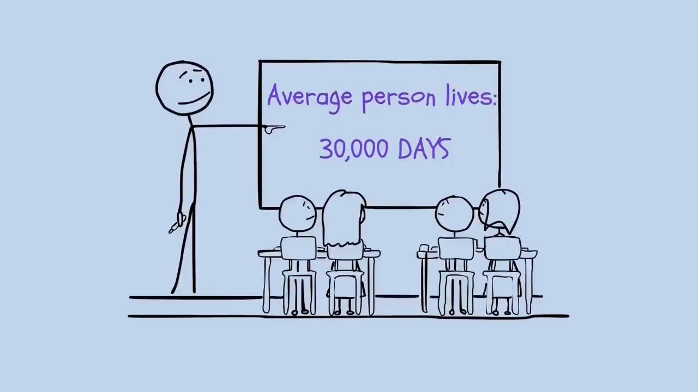
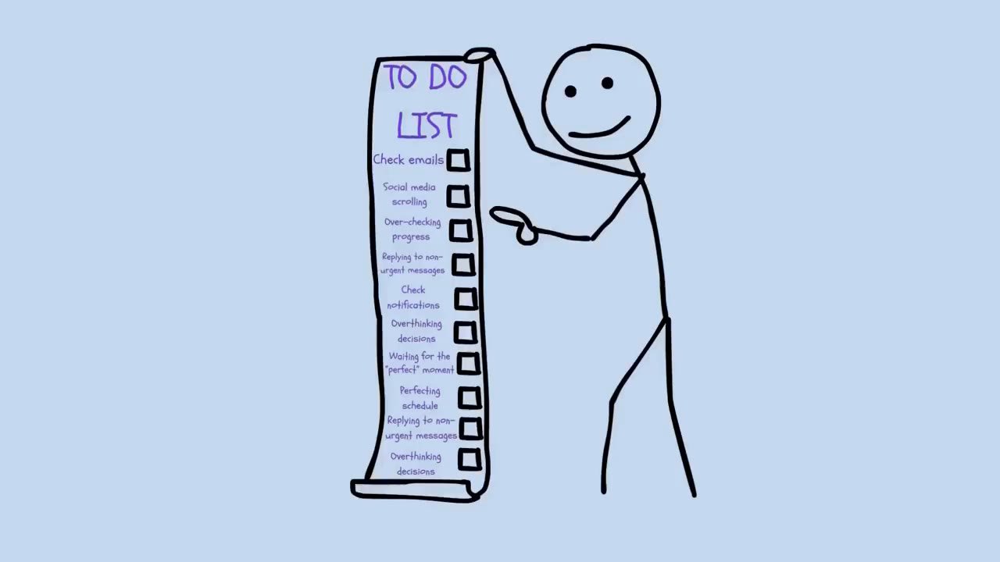
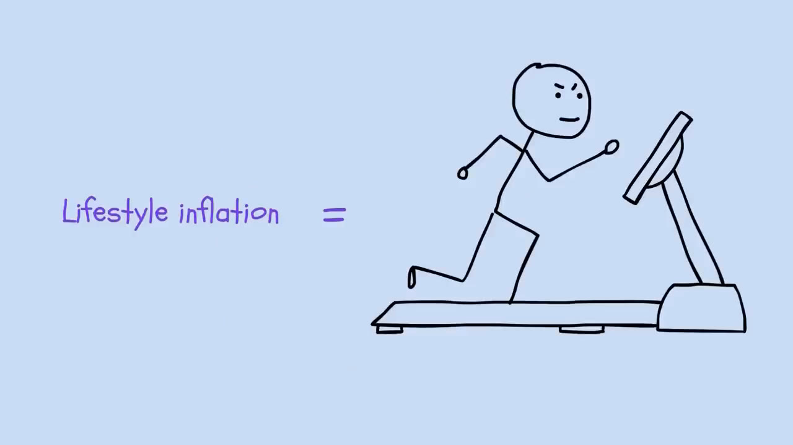

# 三十岁，三万天已经用掉一万一千天

一辈子平均也就三万天上下，三十岁的时候已经用掉了大约一万一千天，Productive Peter 那期 Life is Short 开头就丢了这个数，2024 年 12 月发的，17 分钟，分了十三章，挑三段记一下。

▲ 黑板上写着 Average person lives: 30,000 DAYS，底下几个人坐着听

> Someday is a dangerous word.
> 哪天是个危险的词。
> —— Productive Peter

第一段讲时间为什么越过越快，按视频的说法，大脑是靠记录新经历来计时的，小孩看什么都新，一直在记，大人每天同样的早饭同样的通勤，大脑干脆跳过不记，日子就糊成一片，办法也不复杂，换条路上班，每个月学一样新东西，和陌生人聊几句。

第二段是两张清单，把想做成的事全写下来，圈出最重要的三件，剩下的全部进避免清单，还是那个意思，知道不做什么，比知道做什么更有用。

▲ 小人拎着一长卷 TO DO LIST，一格一格的方框还没打勾

第三段讲钱，收入涨了生活跟着膨胀，房子大了要打理，车好了要操心，住进好小区通勤更远，讲者说这像在跑步机上，跑得很快，哪儿也没去，他还问了一句，每周干八十小时赚十万美元，和每周干三十小时赚七万美元，选哪个，真实的时薪要把牺牲掉的时间都算进去。

▲ Lifestyle inflation 等号右边，一个小人在跑步机上埋头快跑

后面还有精力、社交、人生设计几章，结尾那句是习惯变成日子，日子变成岁月，岁月变成一生，讲者的建议是挑一个打动你的想法先试一试。

- 每个月做一件没做过的事
- 待办只圈三件，其余进避免清单
- 算一下自己真实的时薪，通勤和加班都算进去

八十小时十万和三十小时七万，换你选哪个，评论区说下。

视频链接 youtube.com/watch?v=Xtxscxi83XA
